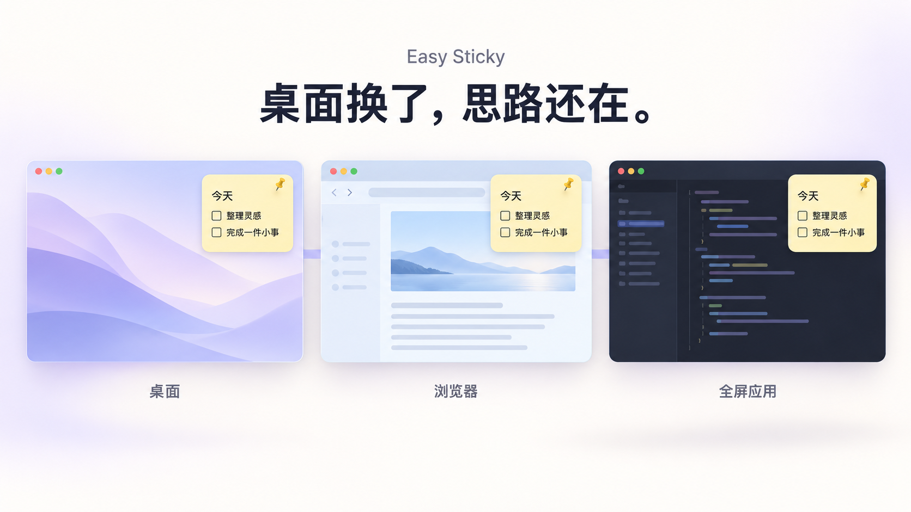
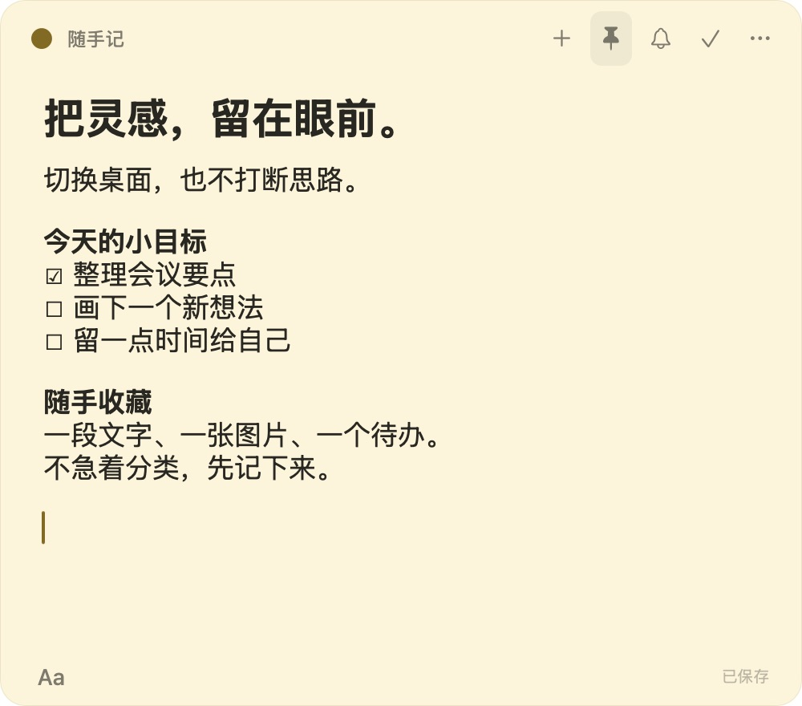
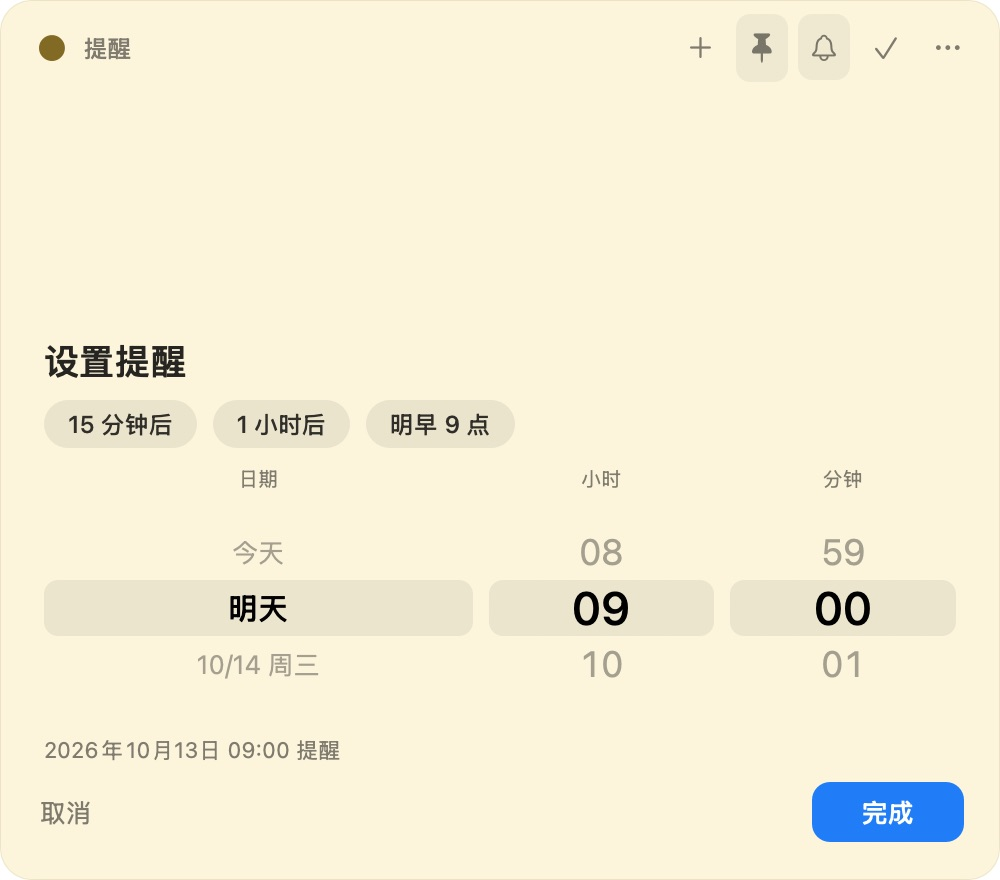

<div align="center">

# Easy Sticky

### 桌面换了，思路还在。

一款原生 macOS 便签，把待办、参考资料与灵感留在眼前。

**跨 Space 查看 · 全屏可见 · 富文本与原图 · 本地保存**

[快速开始](#快速开始) · [功能预览](#功能预览) · [快捷键](#快捷键) · [数据与权限](#数据与权限)



<sub>跨 Space 概念图，由 AI 生成，非实机截图。同一台 Mac 的不同工作空间，不代表跨设备同步。</sub>

**macOS 13+** · **Swift 5.10+** · **AppKit** · **v0.3.3**

</div>

---

## 切换的是桌面，不是思路

在浏览器查资料，到编辑器写东西，再切到全屏应用。工作分布在不同 Space，参考内容不必跟着消失。

开启 **固定到所有桌面** 和 **置顶显示**，便签可在普通桌面及其他应用的全屏桌面中继续查看。每张便签也可以独立取消置顶，或只留在当前桌面。

| 想做什么 | Easy Sticky 帮你做什么 |
| --- | --- |
| 随手记录一个想法 | 快捷新建，直接输入，自动保存 |
| 一边工作，一边看参考 | 跨 Space 与全屏显示，独立置顶 |
| 收藏一段有格式的文字 | 从选区新建，优先保留来源提供的富文本 |
| 保存截图或长图 | 保存输入原图数据，随便签宽度等比展示 |
| 提醒自己晚点处理 | 便签内设置时间，通过 macOS 通知提醒 |

## 功能预览

### 一张便签，放下文字、清单与灵感

点击左下角 **Aa** 展开格式工具：标题、粗斜体、下划线、删除线、字号与颜色、列表、待办、代码样式、链接、图片和分隔线。平时收起工具栏，把空间留给内容。

每张便签都有独立的窗口、大小与颜色。8 种柔和主题，帮助区分工作、生活和临时想法。

<p align="center">
  
</p>

<p align="center"><sub>v0.3.3 实机截图，使用演示内容。</sub></p>

**看到好内容，顺手留下。** 在其他应用中选中文字，按 **⌥⌘Y** 新建便签。选区速记与普通粘贴优先保留来源提供的段落、字体、链接和代码样式；如果来源仅提供纯文本或私有格式，则无法完整还原样式。

### 便签可以变小，原图不必缩水

- **存储与展示分开**：文件插入及 PNG/TIFF 图片粘贴保留输入字节，不按便签大小重新编码。
- **随宽度等比缩放**：变窄自动缩小，变宽恢复至不超过图片原始显示尺寸；不裁剪、不拉伸、不放大小图。
- **长图上下滚动**：只调整窗口高度，不改变图片比例。

富文本图片保留来源提供的附件数据。旧版本已经缩小保存的图片，需重新插入原图才能恢复清晰度。

### 记下来，再给它一个时间

点击铃铛，在当前便签内选择日期、小时和分钟，也可以直接选 **15 分钟后 / 1 小时后 / 明早 9 点**。

<p align="center">
  
</p>

<p align="center"><sub>v0.3.3 实机截图：选择时间无需额外弹窗；首次通知权限仍由 macOS 管理。</sub></p>

选好时间，点击 **完成**。到点后通过 macOS 通知提醒，点击通知可打开对应便签。通知可见性与到达时间受系统权限、勿扰模式和系统调度影响。

### 暂时收起，或把事情做完

| 操作 | 内容如何处理 | 如何找回 |
| --- | --- | --- |
| **关闭**当前便签（⌘W） | 只隐藏，保留内容与提醒 | 菜单栏 → 显示全部便签 |
| **完成并归档**（顶部对勾） | 归档内容，取消提醒 | 便签库 → 已归档 → 恢复 |
| **永久删除** | 确认后移除，不提供回收站 | 无应用内恢复入口，重要内容请先备份 |

便签库支持查看当前与已归档便签、搜索正文和恢复内容。恢复归档便签不会重新启用旧提醒。

## 快速开始

当前为源码构建的本地测试版，尚未提供公证安装包或 Mac App Store 版本。

### 环境要求

- macOS 13 或更高版本。
- Swift 5.10 或兼容工具链。
- Xcode Command Line Tools；项目没有第三方 Swift 包依赖。

如未安装命令行工具：

```bash
xcode-select --install
```

### 构建并运行

将本仓库克隆或下载到本地，在仓库根目录运行：

```bash
make app
open ".build/Easy Sticky.app"
```

应用生成于 `.build/Easy Sticky.app`，使用本机 ad-hoc 签名。也可以将它复制到“应用程序”目录后启动。

> 如果遇到 Swift 编译器与 SDK 不兼容，请检查 `swift --version` 和 `xcrun --show-sdk-path`，选择与工具链匹配的已安装 SDK。不要为运行应用关闭系统安全保护。

## 快捷键

| 操作 | 默认组合键 | 生效范围 |
| --- | --- | --- |
| 新建便签 | ⌥⌘N | 全局 |
| 从选中文字新建 | ⌥⌘Y | 全局，需辅助功能权限 |
| 显示 / 隐藏全部 | ⌥2 / ⌥3 | 全局，不包含已归档便签 |
| 切换显示 / 隐藏 | ⌥⌘S | 全局 |
| 新建 / 关闭当前便签 | ⌘N / ⌘W | 焦点在便签内时 |

⌘ = Command，⌥ = Option。全局新建、选区速记、显示全部与隐藏全部可在 **偏好设置 → 快捷键** 中修改或恢复默认。标准的复制、粘贴、剪切、全选与撤销快捷键保持不变。

## 数据与权限

**无需账号，便签留在本机。** 不上传便签正文，不提供云同步或多人协作。

```text
~/Library/Application Support/EasySticky/
├── notes.json
└── notes.backup.json
```

内容、富文本、图片与窗口状态自动保存。通过 **偏好设置 → 数据** 打开目录，复制整个目录即可备份；主文件损坏时应用会尝试从本地备份恢复。

| 权限 | 用于什么 | 不授权的影响 |
| --- | --- | --- |
| 通知 | 发送定时提醒 | 无法保存并发送系统提醒，不影响普通记录 |
| 辅助功能 | 从其他应用选区新建便签 | 不影响手动记录及普通复制粘贴 |

选区速记会临时使用剪贴板获取富文本，并恢复原内容；应用不读取剪贴板历史。通知被拒绝时，在 **系统设置 → 通知 → Easy Sticky** 开启后，回到便签重新保存提醒。

## 开发与验证

```bash
make build                            # 构建应用
make test                             # 核心数据与窗口几何检查
swift run EasySticky --check-features # 原生编辑器与图片等功能检查
make smoke                            # 打包、签名及启动 smoke
```

功能检查使用独立测试数据，不加载个人便签。GUI smoke 仅在可用的 macOS 图形会话中运行；无图形会话时明确跳过。

**自动检查不等于跨 Space 实测。** 全屏显示、四指切换动画、触控板滚轮手感、辅助功能授权后的跨应用选区捕获，仍需在目标系统与应用中进行人工验证。详细验证范围见 [功能对照与验收](docs/competitor-parity.md)。

### 代码结构

```text
Sources/
├── EasySticky/           # AppKit 窗口、编辑器、提醒与快捷键
├── EasyStickyCore/       # 便签模型、本地存储与窗口几何
└── EasyStickyCoreChecks/ # 自包含核心检查
Resources/                # 应用元信息
scripts/                  # 构建与 smoke 脚本
docs/                     # 产品背景、验证记录与展示素材
```

历史产品基线见 [产品方案](docs/product-plan.md)，当前行为以实现与验收记录为准。临时数据、个人便签、构建产物和凭据不纳入版本管理。

---

<div align="center">

**下一次切换桌面，让想法留在眼前。**

</div>
